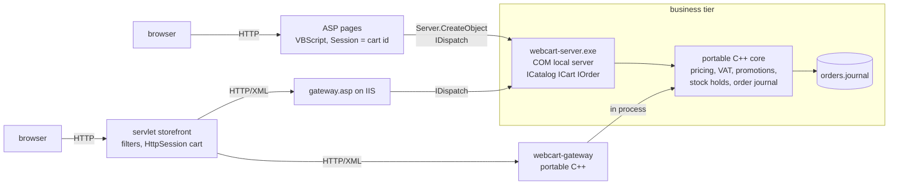

# webcart-1998

A three-tier e-commerce shopping cart in the 1998 style: a COM local server in C++ as the business tier, classic ASP pages and a Java Servlet storefront in front of it, and an HTTP/XML gateway bridging Java to COM.


```
$ ./build/webcart-demo data
== shopper A fills a cart
apply WELCOME10: ok
  sku        item                                qty       net      disc  vat%
  TEA-001    Smoked black tea 100 g                3     19.50      7.80 10.00
  BOOK-100   Field guide to loose-leaf tea         1     18.00      1.80  4.00
  POT-020    Cast iron teapot 0.8 l                2     98.00      9.80 22.00
  VAT  4.00% on     16.20 =     0.65
  VAT 10.00% on     11.70 =     1.17
  VAT 22.00% on     88.20 =    19.40
  subtotal 135.50  discount 19.40  vat 21.22  total EUR 137.32
...
== shopper B competes for the last teapot
B adds 2 x POT-020: OUT_OF_STOCK (only 1 left of POT-020)
(20 minutes pass, A's holds lapse)
B adds 2 x POT-020: ok
A checks out: OUT_OF_STOCK (only 1 left of POT-020)
...
== crash during the next order write, then restart
replayed 1 order(s), discarded 1 incomplete, truncated 66 bytes
```

## What it demonstrates

- **An out-of-process COM server written by hand**: MIDL-compiled `ICatalog`, `ICart` and `IOrder` dual interfaces, `IUnknown`/`IDispatch`/`ISupportErrorInfo` without a template library, `IDispatch` delegated to the type library, class objects registered suspended and resumed together, an idle linger before exit, and self-registration per user (`HKCU`) or machine-wide with an AppID for DCOM security.
- **Business errors that survive every boundary**: one error code set becomes a `FACILITY_ITF` HRESULT plus `IErrorInfo` text for COM, `Err.Number`/`Err.Description` in VBScript, an error element in the gateway XML and a typed exception in Java.
- **Cart pricing that adds up**: integer cents, automatic multi-buy and code promotions, order discounts spread over lines with the largest remainder method, and VAT computed per rate on the discounted base.
- **Stock reservation with timeouts**: soft holds with a sliding expiry, released by a sweep, taken again at checkout, never oversold under concurrent shoppers.
- **A transactional order journal**: write-ahead groups closed by a checksummed commit record; restart replays committed orders into stock and order numbers and truncates a torn tail.
- **Two storefronts on one business tier**: ASP pages with VBScript include libraries and `Session` holding only a cart id, and a JSP-free servlet storefront with filters and an `HttpSession` cart that replays itself when the business tier has dropped the cart.
- **Java to COM over HTTP/XML**: one request/response protocol served by `gateway.asp` on IIS or by the portable `webcart-gateway`, so the Java side never needs a native bridge.

## Architecture



The business logic lives in `core/` as portable C++17 with no platform headers, so it builds and is unit-tested on Linux. `com/` wraps it as a COM local server: the objects are thin adapters that convert BSTRs, map exceptions to HRESULTs and serve `IDispatch` from the type library. `asp/` is the classic front end; its VBScript lives in `asp/lib/*.vbs`, loaded by the pages with `<script runat="server" src>` and by the tests with `cscript`. `servlet/` is the Java storefront; `lab.webcart.store` holds the gateway client, validation, HTML rendering and the session cart with no servlet dependency, and `lab.webcart.web` holds the servlets and filters. The gateway protocol is defined once in `core/include/webcart/gateway_protocol.hpp`, and the XML documents for catalog, cart and order come from the core in every path. Deployment on IIS, DCOM permissions and the HRESULT table are in [docs/deploy-iis.md](docs/deploy-iis.md).

## Quickstart

Linux (core, gateway, Java logic):

```
cmake -S . -B build -DCMAKE_BUILD_TYPE=Release
cmake --build build -j
ctest --test-dir build --output-on-failure        # GoogleTest suites + demo
./build/webcart-demo data
scripts/check-java.sh build/webcart-gateway        # javac only: cart logic + gateway contract
mvn -B -f servlet/pom.xml test -Dwebcart.gateway.bin="$PWD/build/webcart-gateway"
```

The Maven step downloads `jakarta.servlet-api` (provided scope), JUnit 5 and Jetty 12 for the embedded-container test. Without `-Dwebcart.gateway.bin` that test runs against an in-memory fake instead of the C++ gateway. To try the servlet storefront by hand, start `./build/webcart-gateway --port 8099` and deploy `servlet/target/webcart-servlet-1.0.0.war` (`mvn -f servlet/pom.xml package`) to any Servlet 6 container.

Windows (COM server and tests), from an MSVC x64 developer prompt:

```
cmake -S . -B build -G "NMake Makefiles" -DCMAKE_BUILD_TYPE=Release -DWEBCART_BUILD_TESTS=OFF
cmake --build build
cscript //nologo tests\asp_logic.vbs
build\com\webcart-server.exe /RegServerPerUser -idle 60
cscript //nologo tests\com_smoke.vbs
build\com\com_client_test.exe
build\com\webcart-server.exe /UnregServerPerUser
```

Use `/RegServer` from an elevated prompt instead when the callers run elevated or under IIS.

## Design decisions

1. **COM cart objects are handles; the cart lives in the server process.**
   *Why:* an ASP page keeps a short string in `Session` and binds a fresh handle per request with `cart.Open(id)`. Storing a COM object in `Session` ties the session to the apartment that created it, so ASP serves that session from one thread, and couples the object's lifetime to the session; a string does neither, and the same cart id works from the Java side through the gateway.
   *Trade-off:* each property read is a cross-process call, so a page showing N lines makes several calls per line (`ToXml` exists for one-shot reads), and the server must linger after the last client releases its objects or carts would vanish between requests.

2. **Dual interfaces with automation types and the type library marshaler.**
   *Why:* VBScript can only call `IDispatch`, C++ wants vtable calls, and type library marshaling means the `.tlb` is the only artifact to register, locally or over DCOM. `IDispatch` is delegated to `DispInvoke`, so both paths run the same method bodies and failing calls reach scripts as `Err` with the right number and text.
   *Trade-off:* only automation types cross the boundary: amounts are 32-bit `long` cents (about 21 million euro per value), strings are BSTR and converted to UTF-8 at the edge, and remote clients need the type library registered too.

3. **VAT per rate on the discounted base, discounts allocated by largest remainder.**
   *Why:* an invoice states VAT per rate; rounding per line drifts by a cent on larger carts (a test pins the case). Allocating an order-level discount across lines in proportion to their value, with remainders handed out by size, makes line discounts sum exactly to the order discount and gives each VAT rate its correct base.
   *Trade-off:* a single line has no exact VAT figure of its own, and the rounding policy (half away from zero) is fixed in code rather than configured per jurisdiction.

4. **Soft stock reservations with a sliding timeout, retaken at checkout.**
   *Why:* adding to the cart holds stock, so two shoppers cannot both buy the last unit, but an abandoned cart releases it after 15 idle minutes without a cleanup job: a sweep runs at the start of every business call.
   *Trade-off:* a shopper who pauses can lose a hold and see checkout fail on stock; the cart keeps the lines and reports which ones are unreserved, so the page can explain it.

5. **The order journal is the commit point.**
   *Why:* an order is written as one group closed by a checksummed commit record before memory changes. If the write fails, nothing is applied and the cart keeps its holds; on restart, committed groups rebuild stock and the order counter, and a torn tail is cut off so the next append starts clean.
   *Trade-off:* the write is flushed to the OS but not forced to disk, the file is never compacted, and carts (unlike orders) do not survive a server restart.

6. **Java reaches COM over HTTP/XML, and the servlet session can rebuild the cart.**
   *Why:* a servlet container cannot activate a DCOM object without a native bridge; a small XML protocol over HTTP keeps the Java side pure and lets the same storefront run against `gateway.asp` on IIS or the portable gateway. The `HttpSession` keeps the business-tier cart id and a copy of the requested lines; if the business tier reports the cart unknown, the copy is replayed into a new cart and the shopper is told what could not be restored. A restored cart is never ordered silently.
   *Trade-off:* an extra network hop and XML parse per action, and two copies of the cart reconciled by a simple rule (the business tier's answer always wins).

## Scope and limits

- No accounts, payments, shipping or tax rules beyond one VAT rate per product.
- No CSRF tokens on the forms and no HTTPS setup; the receipt pages only show the order placed by the same session.
- IIS hosting of the ASP pages is documented in `docs/deploy-iis.md` but not exercised in CI; CI runs the pages' VBScript libraries under `cscript` and the gateway logic against the real COM server.
- Remote DCOM activation is described, not tested; CI activates the server locally.
- `webcart-gateway` serves one connection at a time and binds to 127.0.0.1 by default.
- The COM server takes ANSI-code-page paths for its data and journal files.
- Catalog and promotions are loaded from CSV at start-up; there is no back office for stock or prices.

## About this lab

A compact reference implementation written in 2026. It reconstructs the architecture of an e-commerce shopping cart I built in 1998 with Java Servlets, server-side DCOM components and ASP pages on IIS, without reproducing any proprietary design.

## License

MIT, see [LICENSE](LICENSE).
